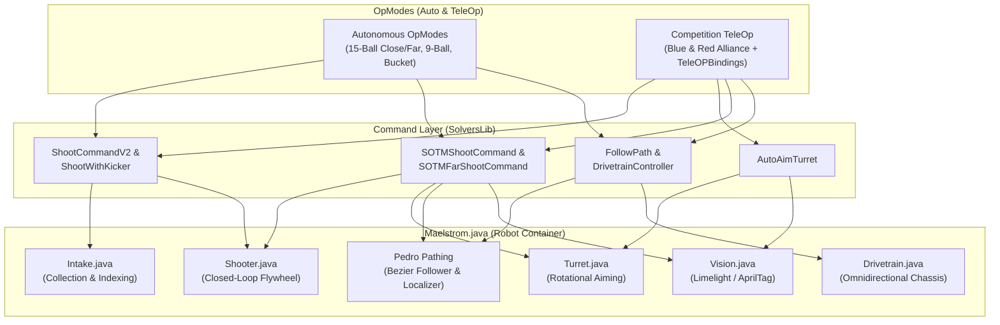
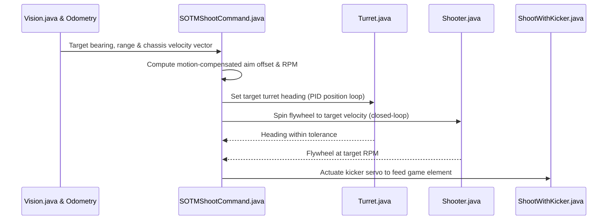
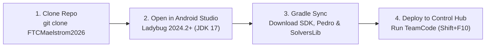

<div align="center">


# FTC Team 3846 Maelstrom — 2025–2026 Robot Codebase

**Official Competition Software • [Middleton Robotics](https://www.middletonrobotics.com/) • Middleton High School (Tampa, FL)**  
Built for the 2025–2026 *[FIRST Tech Challenge DECODE](https://ftc-resources.firstinspires.org/ftc/archive/2026/game)* Season

[**Explore Repository**](https://github.com/MiddletonRobotics/FTCMaelstrom2026) · [**FTC SDK Docs**](https://ftc-docs.firstinspires.org/ftc_sdk/overview/index.html) · [**Pedro Pathing**](https://github.com/Pedro-Pathing/PedroPathing) · [**SolversLib**](https://docs.seattlesolvers.com/)

</div>

## Architecture & Highlights

The **FTCMaelstrom2026** codebase uses a modular, command-based architecture built on top of the official [FIRST Tech Challenge FtcRobotController SDK](https://github.com/FIRST-Tech-Challenge/FTCRobotController). It integrates [SolversLib](https://github.com/FTC-23511/SolversLib) for subsystem and command scheduling alongside [Pedro Pathing](https://github.com/Pedro-Pathing/PedroPathing) for continuous-curve autonomous navigation and localization.



Key capabilities implemented in this repository include:

* **Shot-On-The-Move (SOTM) Ballistics:** Real-time velocity compensation and turret tracking (`SOTMShootCommand.java` and `SOTMFarShootCommand.java`) that allow the robot to score accurately while translating across the field.
* **Vision-Guided Turret Auto-Aiming:** Automated rotational alignment (`AutoAimTurret.java` and `Vision.java`) that tracks field targets and adjusts turret heading and hood/flywheel parameters dynamically.
* **Multi-Cycle Autonomous Routines:** High-efficiency 9-element and 15-element autonomous trajectories for both Red and Blue alliances across Close and Far starting zones, including spike-mark variations.
* **Alliance-Specific TeleOp Controls:** Dedicated competition driver configurations (`BlueCompetitionTeleOP.java`, `RedCompetitionTeleOP.java`, and `TeleOPBindings.java`) alongside diagnostic and manual calibration OpModes.

## Shot-On-The-Move (SOTM) & Vision Control Pipeline

During both autonomous cycles and driver-controlled scoring, the robot fuses localization pose data with vision rangefinding to dynamically offset turret angle and flywheel velocity while moving:



## Repository Structure

| Path | Description |
| :--- | :--- |
| `FtcRobotController/` | Official [FTC Robot Controller SDK](https://github.com/FIRST-Tech-Challenge/FTCRobotController) Android application module |
| `TeamCode/` | Custom competition code module for [FTC Team 3846 Maelstrom](https://github.com/MiddletonRobotics/FTCMaelstrom2026) |
| `TeamCode/.../Subsystems/` | Hardware abstraction classes for drivetrain, shooter, turret, intake, and vision |
| `TeamCode/.../Commands/` | Reusable command routines for shooting, turret aiming, path following, and parking |
| `TeamCode/.../OpModes/Auto/` | Competition and demonstration autonomous OpModes for Red and Blue alliances |
| `TeamCode/.../OpModes/TeleOp/` | Driver-controlled competition OpModes and hardware troubleshooting tools |
| `TeamCode/.../Paths/` | Trajectory definitions and waypoints for autonomous routines |
| `TeamCode/.../pedroPathing/` | [Pedro Pathing](https://github.com/Pedro-Pathing/PedroPathing) follower configuration, constants, and tuning |
| `TeamCode/.../Utilities/` | PID controllers, mathematical helpers, and shared robot constants |
| `build.common.gradle` | Shared Gradle configuration and Maven repository declarations |
| `build.dependencies.gradle` | External library dependencies including [Pedro Pathing](https://github.com/Pedro-Pathing/PedroPathing) and [SolversLib](https://github.com/FTC-23511/SolversLib) |

## Hardware Subsystems (`TeamCode/.../Subsystems/`)

All physical mechanisms on the robot are abstracted into modular subsystem classes inside `TeamCode/src/main/java/org/firstinspires/ftc/teamcode/Subsystems/`:

| Subsystem Class | Primary Responsibilities |
| :--- | :--- |
| `Maelstrom.java` | Top-level robot container that initializes all subsystems, sensors, and hardware map bindings |
| `Drivetrain.java` | Omnidirectional chassis control, field-centric kinematics, and localization pose updates |
| `Shooter.java` | Closed-loop flywheel velocity control and element launching mechanics |
| `Turret.java` | Rotational turret control with soft limits, encoder feedback, and target heading tracking |
| `Intake.java` | Game element collection, transfer indexing, and jam-clearing states |
| `Vision.java` | Camera/Limelight pipeline integration for AprilTag detection, rangefinding, and target locking |

## Commands (`TeamCode/.../Commands/`)

Command classes inside `TeamCode/src/main/java/org/firstinspires/ftc/teamcode/Commands/` combine subsystem actions into composable routines for both autonomous and driver-controlled periods:

| Command Class | Function |
| :--- | :--- |
| `AutoAimTurret.java` | Continuously rotates the turret to maintain lock on the scoring target using vision and odometry data |
| `SOTMShootCommand.java` | Executes close-to-mid-range Shot-On-The-Move compensation by offsetting aim and flywheel speed for chassis velocity |
| `SOTMFarShootCommand.java` | Executes long-range Shot-On-The-Move calculations for far-zone autonomous and teleop scoring |
| `ShootCommandV2.java` | Coordinates flywheel spin-up verification and kicker actuation for rapid multi-element scoring |
| `ShootWithKicker.java` | Feeds held game elements into the spinning flywheel via the kicker servo |
| `FarShootCommand.java` | Configures shooter velocity and turret angle for stationary long-distance shots |
| `FinalShootCommand.java` | Clears remaining held elements at the end of an autonomous cycle |
| `Shoot.java` | Base shooting command for standard scoring cycles |
| `DrivetrainController.java` | Processes gamepad inputs and applies field-centric or robot-centric velocity vectors to the drivetrain |
| `FollowPath.java` | Wraps [Pedro Pathing](https://github.com/Pedro-Pathing/PedroPathing) trajectory execution as a schedulable command |
| `ParkCommand.java` | Navigates the robot into the designated parking zone at the conclusion of autonomous |

## Competition OpModes (`TeamCode/.../OpModes/`)

OpModes are organized under `TeamCode/src/main/java/org/firstinspires/ftc/teamcode/OpModes/` into `Auto` and `TeleOp` packages:

### Autonomous OpModes (`OpModes/Auto/`)

| OpMode Class | Alliance | Starting Zone & Strategy |
| :--- | :--- | :--- |
| `FifteenCloseBlue.java` | Blue | Close zone high-capacity 15-element cycle routine |
| `FifteenCloseRed.java` | Red | Close zone high-capacity 15-element cycle routine |
| `FifteenFarBlue.java` | Blue | Far zone 15-element routine using long-range trajectories |
| `FifteenFarBlueWSpike.java` | Blue | Far zone 15-element routine incorporating spike-mark element collection |
| `FifteenFarRed.java` | Red | Far zone 15-element routine using long-range trajectories |
| `FifteenFarRedWSpike.java` | Red | Far zone 15-element routine incorporating spike-mark element collection |
| `NineBallCloseBlue.java` | Blue | Close zone 9-element scoring cycle routine |
| `BucketAutoBlueClose.java` | Blue | Close zone bucket-scoring autonomous routine |
| `FarShootAuto.java` | Both | Long-range autonomous shooting routine from the far starting position |
| `LeaveAuto.java` | Both | Minimal autonomous routine to clear the starting area and score parking points |
| `DemoAuto.java` | Both | Demonstration autonomous routine for outreach and system checks |

### TeleOp & Diagnostic OpModes (`OpModes/TeleOp/`)

| OpMode Class | Purpose |
| :--- | :--- |
| `BlueCompetitionTeleOP.java` | Primary competition driver-controlled OpMode configured for Blue alliance target coordinates |
| `RedCompetitionTeleOP.java` | Primary competition driver-controlled OpMode configured for Red alliance target coordinates |
| `TeleOPBindings.java` | Centralized gamepad button and trigger mappings for primary and secondary drivers |
| `ManualTurret.java` | Manual turret rotation control for testing and fallback operation |
| `ManualSetTurret.java` | Utility OpMode for setting and verifying turret zero-offsets and encoder limits |
| `TurretTroubleshooting.java` | Diagnostic telemetry OpMode for PID tuning and hardware verification of the turret subsystem |
| `DanceDemo.java` | Choreographed movement routine used during community STEM demonstrations |

## Dependencies & Libraries

<div align="left">
  <a href="https://github.com/FIRST-Tech-Challenge/FTCRobotController">
    
  </a>
  &nbsp;&nbsp;
  <a href="https://github.com/Pedro-Pathing/PedroPathing">
    
  </a>
  &nbsp;&nbsp;
  <a href="https://github.com/FTC-23511/SolversLib">
    
  </a>
</div>

* **[FIRST Tech Challenge FtcRobotController SDK](https://github.com/FIRST-Tech-Challenge/FTCRobotController):** Official Android control system workspace and hardware APIs ([FTC SDK Documentation](https://ftc-docs.firstinspires.org/ftc_sdk/overview/index.html)).
* **[Pedro Pathing](https://github.com/Pedro-Pathing/PedroPathing):** Bezier-curve trajectory generator and follower used for smooth, high-speed autonomous pathing (`PedroAutoSample.java`, `PedroTeleOpSample.java`, and `pedroPathing/`).
* **[SolversLib](https://github.com/FTC-23511/SolversLib):** Community-maintained fork of FTCLib providing command-based scheduling, gamepad wrappers, and control system utilities ([SolversLib Documentation](https://docs.seattlesolvers.com/)).

## Setup & Build Instructions



### Prerequisites

1. **Android Studio:** Install Android Studio (Ladybug 2024.2+ or newer recommended) configured with the Android SDK and JDK 17.
2. **Hardware Control System:** REV Robotics Control Hub running the matching FTC Robot Controller firmware and a Driver Hub or Android device running the FTC Driver Station app.

### Cloning and Building the Project

1. **Clone the repository:**
   ```bash
   git clone [https://github.com/MiddletonRobotics/FTCMaelstrom2026.git](https://github.com/MiddletonRobotics/FTCMaelstrom2026.git)
   cd FTCMaelstrom2026
   ```
2. **Open in Android Studio:**
   Launch Android Studio, choose **Open**, and select the cloned `FTCMaelstrom2026` root directory. Allow Gradle to sync and download all required dependencies declared in `build.dependencies.gradle` and `TeamCode/build.gradle`.
3. **Build and deploy to the Control Hub:**
   Connect to the REV Control Hub over Wi-Fi Direct or USB-C, select the `TeamCode` run configuration in the top toolbar, and click **Run** (`Shift + F10`) to install the application onto the robot.

## About Middleton Robotics

Founded in 2004 at Middleton High School in Tampa, Florida, **[Middleton Robotics](https://www.middletonrobotics.com/)** is a student-led robotics organization home to *[FIRST Tech Challenge](https://www.firstinspires.org/programs/ftc/game-and-season)* teams including **[FTC Team 3846 Maelstrom](https://roboticon.net/2019/10/06/meet-ftc-team-3846-maelstrom/)**, Mythos, Midnight, and Masquerade, as well as *[FIRST Robotics Competition Team 1369 Minotaur](https://roboticon.net/2026/09/30/roboticon-2026-team-spotlight-meet-team-1369-middleton-robotics-tampa/)*. Beyond competition, team members run [Middleton Robotics Summer Camps](https://www.middletonrobotics.com/summercamps) and mentor local schools across the Tampa Bay community.
